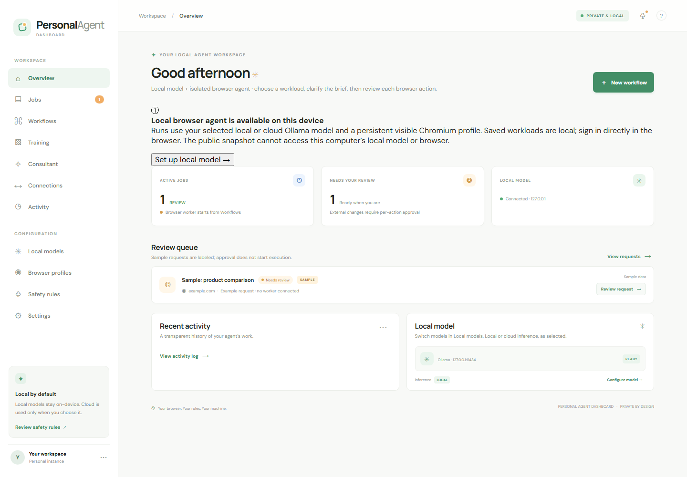

# Personal Agent — Local Browser Agent Dashboard

Local-first dashboard for running actual local language models through Ollama and for driving an isolated, visible Chromium browser through reviewable workflows. The public gallery hosts only the interface: it cannot access a visitor's computer, Ollama service, or browser worker. Model chat and browser workflows work only when the app runs locally on the same computer as Ollama. Workflows stay review-only end to end: every fill/click is proposed, logged, and individually approved before it happens, and the run always ends paused for human review — never auto-completed. This is not a production-ready browser agent.

## What this is, and how it was built

Personal Agent makes it dramatically easier to run browser-based software — including heavyweight creative web apps — by putting an agent in the loop that operates the browser for you, under your supervision. You describe the job; the agent navigates, fills, clicks, and reports back, and you approve every action.

Plain-language provenance:

- **Built with** [Hermes](https://hermes-agent.nousresearch.com) (an open-source agent harness) running **inkling-2-small**, a cloud model at roughly **$1.00 per million output tokens**. The initial export was prepared with that stack; subsequent packaging and verification changes are recorded in Git history.
- **Powered by Ollama.** Any Ollama model can be used — pick one from `ollama list`, or pull one you like. A cheaper cloud option is **GLM-5.3 Flash** at about **$0.50 per million output tokens** (Ollama pricing as of November 2026 — check [ollama.com/pricing](https://ollama.com/pricing) before budgeting). If you have a GPU, you can likely run capable open models locally and pay nothing per token.
- **Easiest install:** point an agent at this repository and tell it to install and set it up — **Hermes, Grok Bot, or Meta Muse** can all do this, and can stay on afterwards as your assistant for making changes to the program itself.
- **The agent knows the open-source ArtCraft tool series** ([getartcraft.com](https://getartcraft.com) — FilmCraft, PhotoCraft, VectorCraft, SoundCraft and friends) and can drive those tools to produce work. We used **FilmCraft together with VideoExpress** to assemble the final edit of the example Rainbow Garden video (see Releases for the finished film; the song ships in `media/rainbow-garden/`).
- **Video editing can be as simple as this conversation:** tell the agent the order of the shots and where the cuts fall in seconds; it computes the timeline, assembles it with **FFmpeg** (which can also analyze the audio waveform / detect silence), and verifies the result frame by frame with a vision-capable model.

## Third-party services (read before use)

Personal Agent itself is open source and free to use. It is an automation client — it does not include, unlock, or substitute for the third-party services its example workflows target:

- **VideoExpress** and **CloneVoice** are paid subscriptions (by Paul Ponna). A valid subscription is required to use them; Personal Agent requires your own account and your own login, entered by you in the isolated browser window.
- Personal Agent is not affiliated with, endorsed by, or supported by VideoExpress, CloneVoice, or their creators.
- No content produced by those services is included in this repository. Screenshots elsewhere in this document show Personal Agent's own UI only.

## The Rainbow Garden (media, CC BY-SA)

The repo ships the project's example children's song, independently licensed from the code: **"The Rainbow Garden" by Michael Barnes, CC BY-SA 4.0** — see `media/rainbow-garden/`. Code remains MIT; the song and lyrics are the artist's work under CC BY-SA. See that folder's README for provenance details.

## Requirements

- Windows, macOS, or Linux with Git, Node.js 20+ and npm. Use the current Node.js LTS release where possible.
- Ollama installed and its local service running at `http://127.0.0.1:11434`.
- At least one **local, non-cloud** Ollama model downloaded. Do not use an Ollama model tagged `:cloud`.
- For browser workflows, a Playwright-supported Chromium installation. The commands below install Playwright's Chromium; on Linux, install any system libraries Playwright reports as missing.

## Agent install and first-run checklist

Follow these steps from a terminal on the computer that will run Personal Agent. Run commands in the order shown. Do not run this app on a public/untrusted host: its local bridge is intended for loopback use.

### 1. Check prerequisites

```sh
node --version
npm --version
git --version
ollama --version
ollama list
```

Confirm Node.js is version 20 or newer, and `ollama list` shows at least one installed model that is not cloud-tagged. If Ollama is not running, start the Ollama application/service before continuing. If no suitable local model is installed, use an approved local model choice and download it with Ollama, for example `ollama pull <model-name>`; do not substitute a `:cloud` model.

### 2. Clone and install dependencies

Replace `<repository-url>` with the GitHub clone URL. Do not clone into an existing unrelated project directory.

```sh
git clone <repository-url> personal-agent
cd personal-agent
npm ci
```

`npm ci` installs exactly the versions recorded in `package-lock.json`. If the repository has no lockfile, use `npm install` instead. If a Windows install fails because `esbuild.exe` is locked, stop any running Personal Agent/Vite process, close editors or terminals holding the project, then retry `npm ci` from the project directory.

### 3. Install the isolated browser (for browser workflows)

```sh
npx playwright install chromium
```

On Linux, if Playwright reports missing OS packages, run `npx playwright install --with-deps chromium` on a supported Linux environment or install the named system packages using that distribution's package manager. Browser workflows launch a separate visible Chromium profile under the ignored `.localpilot/` directory; they do not use the user's regular browser profile.

### 4. Start Personal Agent

In the project directory:

```sh
npm run dev
```

Keep this terminal open. Open the local URL printed by Vite (normally `http://localhost:5173`). Do not expose this development server to a LAN or the public internet. If port 5173 is already occupied, use the URL Vite prints.

### 5. Verify local model chat

1. In the dashboard choose **Local models**.
2. Click **Check connection** and confirm Ollama is reachable.
3. Select an installed non-cloud model under **Active model · Change anytime**.
4. Send a harmless test prompt and confirm a response appears.

If connection checking fails, verify Ollama is running and `ollama list` succeeds in the same user environment. Do not work around the failure with a cloud model or a remote endpoint.

### 6. Verify browser workflows (optional)

1. Open **Workflows** and confirm the browser worker can be started; choose **Start isolated browser**. Confirm a separate Chromium window opens.
2. Use a non-sensitive test site you are authorized to access. Set its exact hostname in the allowlist and a matching `http(s)` target URL.
3. Sign in manually in the visible isolated Chromium window only if required. Never automate or ask an agent to enter passwords, cookies, OTPs, tokens, or payment data.
4. Confirm proposed fills/clicks require explicit per-action approval. Reject any action that is unclear or could submit, publish, send, purchase, delete, or otherwise cause an unintended side effect.

If the browser fails to launch, confirm step 3 completed successfully. The UI's worker API reachability does not necessarily mean Chromium is running; check the browser status shown in the dashboard.

### 7. Run repository checks (recommended before sharing changes)

Stop the dev server with `Ctrl+C`, then run:

```sh
npm run build
npm run lint
```

A build must pass before publishing. Review lint output; do not hide or suppress warnings/errors without understanding them. To run a local production preview after building:

```sh
npm run preview
```

Open the local preview URL printed by Vite and stop it with `Ctrl+C` when finished. The preview's local bridge still requires Ollama on the same computer.

### Data and secrets for installers

`.localpilot/` is created locally and ignored by Git; workflows, browser profile, and credential-vault file are not included in a clone. Credential saving is optional and locked unless the user configures `LOCALPILOT_VAULT_PASSWORD` in the environment **before starting** Personal Agent (the `LOCALPILOT_` prefix and the `.localpilot/` data directory are historical names kept for compatibility with existing installs). Do not set a shared/default password, put the password in source control, or request secrets from the user. Local inference is the default. This version also includes explicitly configured optional provider connectors and cloud-model consent controls; they are not required for local use and are not a fallback. Telegram credentials enable a send-only notifier (see below).

## Quick run (after prerequisites)

```sh
npm ci
npx playwright install chromium
npm run dev
```

Open the local URL printed by Vite, choose **Local models**, click **Check connection**, select an installed non-cloud model, and send a test prompt. Browser workflows additionally require the isolated Chromium setup above. A production preview works with `npm run build && npm run preview`. The public gallery hosts only the interface; its server cannot reach Ollama or a browser worker on the visitor's computer.

## Model selection

Use an installed non-cloud Ollama model for local inference. This updated version also exposes optional cloud-tagged models and explicitly configured provider endpoints; those are remote inference, not local models. Review the UI consent and configuration before using them. Local failures must not silently trigger a provider change.

## Run a browser workflow (local only)

The **Workflows** tab pairs a versioned Markdown workload (`public/workloads/consistent-character-producer.md`) with a think/act/look agent loop over a visible, isolated browser:

1. Set a **Target web app URL** and **Allowed hostnames** (hostnames only; spaces or commas), then **Save workload link**. Activation is blocked until a real URL and matching allowlist are saved.
2. Use the workload assistant with your selected local model to clarify the character brief. Review its draft, edit out anything invented, and confirm your canonical brief — confirmation is required before a Producer workflow can activate.
3. **Start isolated browser** opens a visible Chromium with a dedicated profile in `.localpilot/browser-profile`. Sign in directly in that window if the site asks; the agent never reads or types credentials. Some identity providers (including Google) block automated Chromium with "This browser or app may not be secure" — Personal Agent cannot and must not bypass that check; use a provider-supported regular browser for sign-in instead.
4. **Activate**, then **Run agent in browser**. The loop opens the allowlisted target, inspects the page, and proposes at most 12 one-step actions. Every fill/click waits on your **Approve once / Reject** choice in the UI.
5. Evidence (URL, title, visible text excerpt) is logged after every action. The run ends in the `paused` state with a summary for your review; a model's `done` is a report, not proof, and never a browser action.

The worker refuses, by policy independent of the model, controls that submit forms, generate/upload/publish/send, pay, delete, or carry passwords/OTPs/tokens/payment/file data.

## Local server bridge (`vite.config.ts`)

Development/preview-only middleware under `/__local-model/*`, served only to loopback hosts:

- `GET /health`, `GET /models`, `POST /chat`, `GET /soul` — model discovery and chat; local Ollama is the default, with optional explicit provider configuration.
- `GET/POST /workflows` — saved-workflow CRUD in `.localpilot/workflows.json` with validation: bundled Markdown path, hostname-only allowlist, http(s) target URL matching the allowlist, state machine (`draft/active/running/paused/completed/blocked/cancelled`), and the approved-brief gate for the Producer workload. Atomic temp-file writes.
- `GET /browser-health`, `POST /browser-start` — status of, and local spawn for, `browser-worker.cjs` on `127.0.0.1:4201`.
- `POST /browser` — proxy to the worker's action API.
- `GET/POST/DELETE /settings` — optional encrypted local vault for cloud/Telegram credentials. `POST` with `provider: "telegram"` accepts `{ secret: <bot token>, chatId: "<numeric chat id>" }` (chatId alone may be updated later without re-sending the token). `POST /telegram-test` sends a test message; `POST /telegram-notify` `{ text }` sends a send-only notification (no reading, polling, or receiving). The Workflows UI fires notifications on: approval requested, workflow finished (paused for review), workflow blocked/failed, and clarification model errors. Notifications are best-effort and never block or approve anything.

## Isolated browser worker (`browser-worker.cjs`)

A small Node process (not the dashboard, not your personal browser) that owns one Playwright persistent context:

- Binds to `127.0.0.1:4201` and rejects non-loopback clients.
- Allowlist enforcement: `allow-host` accepts bare hostnames only; `open` accepts http(s) URLs without embedded credentials whose host is allowlisted; the worker re-asserts the allowlist on the current URL after every navigation and approved action.
- `inspect`/`fill`/`click` return bounded page evidence (text capped at 12k characters). An allowlisted click never navigates outside the allowlist.
- Per-action approval broker: fill/click return a pending approval task performed only after an explicit approve call; reject discards it.
- Sensitive-control refusal: password/OTP/token/secret/payment/file fields and submit/generate/upload/publish/send/pay/delete controls are refused for both fill and click.

## Data storage

All state is device-local and gitignored under `.localpilot/`: `workflows.json` (saved workloads), `credentials.enc.json` (AES-256-GCM vault), and `browser-profile/` (Chromium profile). Remove `.localpilot/browser-profile` (worker stopped) to clear browser state; remove workflows from the UI without touching the shared Markdown workload files. Do not expose the Vite dev/preview server to an untrusted network — the bridge trusts loopback.

## Safety boundaries

- No silent model-provider fallback; browser workflows do not expose a shell tool or arbitrary code execution.
- The browser worker is the only automation path, and it is domain-scoped, evidence-capturing, and approval-gated; it never uses your personal browser profile.
- No access to passwords/cookies/OTP/payment fields; credential-free http(s) targets only.
- No automatic publishing, purchasing, or metered generation: the worker blocks the controls outright, and remaining writes still need per-action approval.
- Approval buttons and run results record what actually happened; page content is treated as untrusted data and can never authorize actions.

## Production readiness

This repository is a functional local demo, not a production browser agent. Missing before production: durable/resumable job state beyond the saved-run record, multi-user concerns, a threat-model review, and broader integration/security tests. The public gallery deployment cannot control visitors' local computers. Do not ask users to enter browser passwords, cookies, or API keys.

## Planned implementation order

1. Isolated Playwright worker with a dedicated profile and domain allowlists — implemented in `browser-worker.cjs`
2. Read-only, evidence-capturing workflow and cancellation — implemented in the Workflows tab loop (pause/abort supported)
3. Approval broker for explicitly bounded side effects — per-action approve/reject implemented; durable queues/audit not yet
4. Durable jobs and narrowly scoped MCP/local-app integrations — not started
5. Automated worker, runner, transport, and release-packaging tests exist; comprehensive threat-model review remains outstanding

## Reference

The separate `PersonalAI-Dashboard` project informed architectural review, especially keeping the dashboard/control plane separate from an agent worker and using narrow adapters. This repository is newly authored and does not copy its source code, credentials, or cloud-routing behavior. Verify third-party licenses and automation terms before adopting any code or integration.


## Documentation

- [Architecture decision: browser strategy](docs/browser-architecture-decision.md)
- [The Personal Pilot — concept and rationale](docs/personal-pilot.md)
- [Agentic browser choice — BrowserOS neo vs the isolated worker](docs/agentic-browser-choice.md)
- [Kids' song → picture-book video workflow](docs/workflows/kids-song-video-workflow.md)
- [Video editing & assembly workflow](docs/workflows/video-editing-workflow.md)

These distinguish implemented behavior from aspirations; treat anything not listed here as not yet built.



This screenshot illustrates the local UI, not a completed browser workflow.
